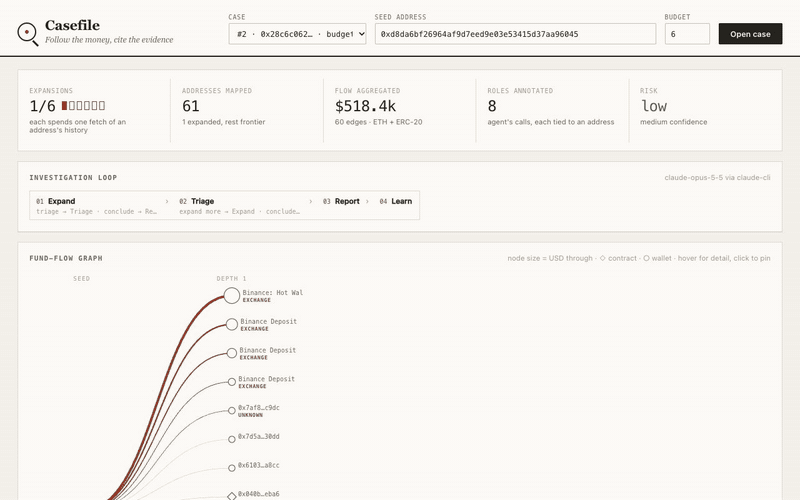
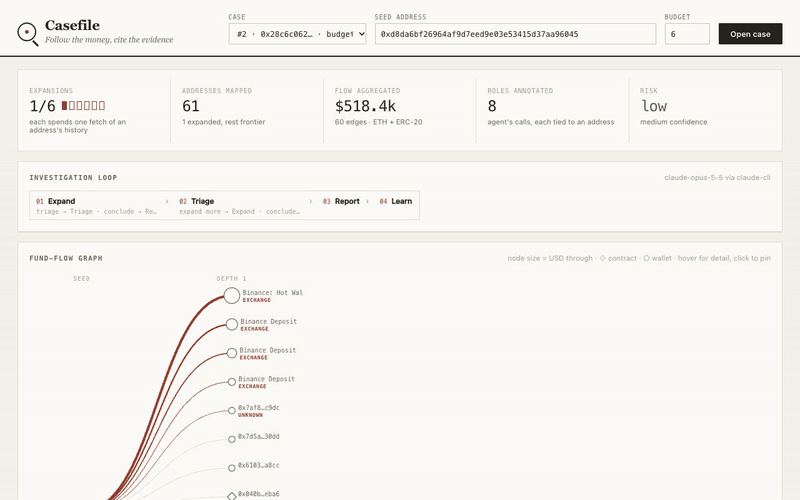
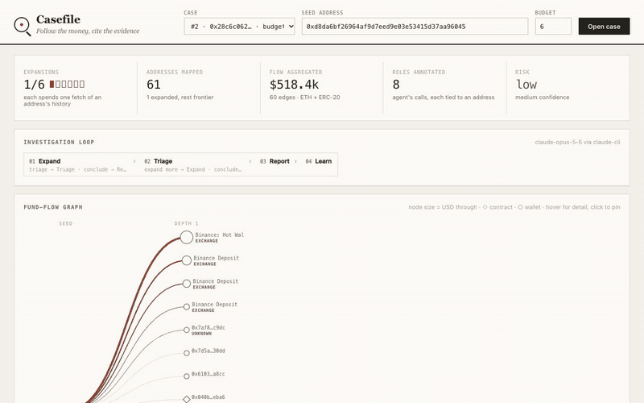
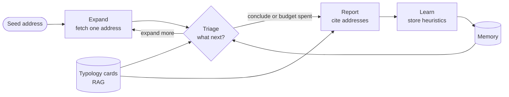

<div align="center">

# Casefile

**Follow the money. Cite the evidence.**<br>
An on-chain investigation agent that works on a fetch budget, treats chain data as hostile, and cannot make a claim without an address to point at.


[Demo](#demo) · [Features](#features-to-try) · [How it works](#how-it-works) · [Quick start](#quick-start) · [Tests](#tests)



</div>

---

## Why

Block explorers show you transactions. Investigators need a **story with receipts**: who funded whom, which
wallets are relays, which "tokens" are bait. Casefile gives an agent an Ethereum address and a fixed number of
fetches, and makes it earn its conclusions.

| Risk when you let an LLM investigate | Casefile's countermeasure |
|---|---|
| Invented numbers | **Facts are computed, claims are modelled.** Volumes, fan-in/out, passthrough ratios and timing come from code; the model only interprets them |
| Prompt injection via on-chain text | **Untrusted-string fencing.** Token names, ENS labels and tags are delimited as adversarial data and can **never add an address to the fetch queue** |
| Endless crawling | **Budgeted loop.** Each expansion spends one fetch of an address's history; the run stops when the budget is gone |
| Claims with no evidence | Every annotation is tied to an address in the graph, and the report cites it |
| Irreproducible cases | Blockscout responses are snapshotted, so a case can be replayed **offline** |

## Demo

<div align="center">

</div>

A finished case on a Binance hot wallet: 61 addresses mapped, \$518k of flow across 60 edges, 8 roles annotated,
and a risk call with its confidence.

## Features to try

### 1. Explore the fund-flow graph: hover for evidence, click to pin



Node size is USD flowing through; circles are wallets, diamonds are contracts. Edge weight is aggregated value.
Hover a node for its explorer label (marked unverified), USD in and out, any scam flag and the agent's role note, click to pin and dim everything unrelated. The graph caps
what it draws and tells you how many nodes are hidden.

### 2. Read the report, the role annotations and the heuristics it learned



The report separates computed facts from model claims. Roles (source, sink, pass-through, service, exchange, mixer-like, victim, unknown) are annotated per
address. After each case the agent stores a heuristic in memory, ranked later by relevance × learned utility, then
the demo switches to a second case (a personal wallet) to show a very different result.

## How it works



- **Graph engineering.** `CaseGraph` aggregates transfers into edges and computes per-entity features
  (passthrough ratio, fan-in, fan-out, activity span) deterministically.
- **RAG.** Typology cards on laundering patterns, scam surfaces and investigation craft, retrieved by hybrid
  BM25 + TF-IDF.
- **Memory.** Heuristics from past cases are stored and ranked by learned utility.
- **Security.** The headless LLM runs with every tool disabled.

## Quick start

```bash
python3 -m venv .venv && source .venv/bin/activate
pip install -r requirements.txt          # needs git access to cacheycat/agentkit
python app.py                            # http://localhost:8812
```

**It works offline.** `demo/snapshots/` holds a trimmed Blockscout snapshot for the demo address, so a fresh clone
runs without network access. Rebuild it with `AGENT_LLM=baseline python scripts/build_demo.py`.

The LLM layer uses `ANTHROPIC_API_KEY`, else a local headless `claude` CLI with tools disabled, else a deterministic
heuristic report.

Working on both repos at once? Link a sibling checkout instead:

```bash
pip install fastapi uvicorn numpy certifi pydantic
ln -s ../agentkit/agentkit agentkit      # ignored by git
```

## API

| Method | Path | Purpose |
|---|---|---|
| GET | `/api/meta` | Provider mode, budgets, demo seed |
| POST | `/api/case` | Open a case for an address |
| GET | `/api/memory` | Stored heuristics with learned utility |
| GET | `/api/runs`, `/api/runs/{id}`, `/api/runs/{id}/events` | Run list, detail, replayable SSE trace |

## Tests

```bash
pip install -r requirements-dev.txt
pytest -q && ruff check .
```

One test replays a full baseline investigation with the network blocked and fails if any call is attempted.

## Part of a set

Built on [agentkit](https://github.com/cacheycat/agentkit), alongside
[holdout](https://github.com/cacheycat/holdout) (blind strategy research) and
[undertow](https://github.com/cacheycat/undertow) (whale positioning desk).

> Analysis tooling. A risk label is a lead for a human, not a verdict.
